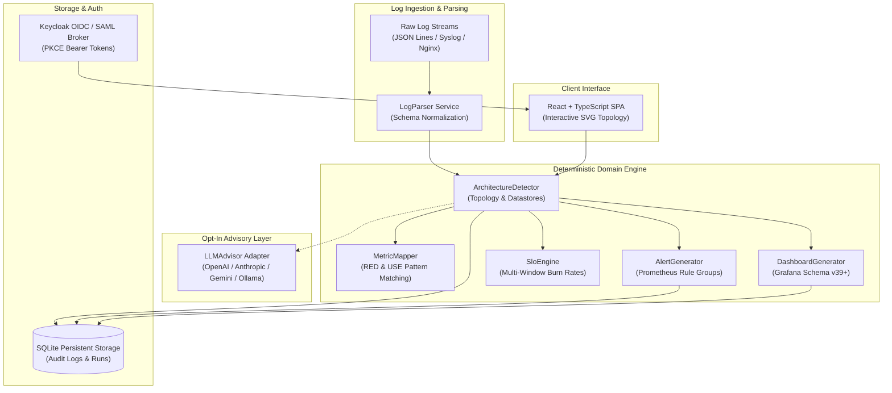

# log-to-observability-alan-vo — Alan Vo | AI & Machine Learning

> Work in progress. This checkpoint may be incomplete or fail tests. See PLAN.md and STATUS.md before use.


Current version: `1.0.0`.

Modern cloud architectures decompose monolithic systems into dozens of ephemeral microservices and datastores, but reverse-engineering service topologies, critical paths, and failure modes from high-volume production logs remains a manual, error-prone task for site reliability engineers (SREs). **log-to-observability-alan-vo** provides an automated AI/ML log-to-observability pipeline that ingests multi-format log streams (JSON lines, Syslog RFC 5424/3164, and Nginx/Apache access logs), deterministically extracts the service architecture, communication graph, and datastore dependencies, and synthesizes production-ready Grafana dashboards, Prometheus alert rules, and Google SRE multi-window burn rate SLOs with opt-in multi-provider LLM advisory assessment.

---

## Architecture



---

## Core Features

- **Multi-Format Log Parser**: Ingests JSON lines, Syslog RFC 5424/3164, Nginx combined access logs, and container stdout with timestamp normalization and duration parsing.
- **Deterministic Architecture Detection**: Reconstructs directed microservice topologies, communication protocols (`http`, `grpc`, `queue`), ingress classification, and datastore dependencies (`postgresql`, `redis`, `kafka`, `mongodb`) without requiring third-party credentials.
- **Failure Pattern Recognition**: Detects timeout spikes, connection pool exhaustion, authentication rejections, and rate limits with exact quoted log lines as evidence.
- **Grafana Dashboard Synthesis**: Produces standard Grafana dashboard JSON (schemaVersion 39+) containing request volumes, 5xx error rate timeseries, p50/p95/p99 latency distributions, and saturation gauges.
- **Prometheus & Alertmanager Rules**: Generates alerting rule groups with Prometheus queries, severity tags (`warning`, `critical`), and runbook annotations.
- **Google SRE Multi-Window SLO Engine**: Calculates availability targets and multi-window burn rate alerts (1h @ 14.4x, 6h @ 6x, 24h @ 1x error budget consumption).
- **Opt-In Advisory LLM Layer**: Configurable multi-provider support for OpenAI-compatible, Anthropic, Gemini, and local Ollama models with bounded timeouts and error redaction.
- **Keycloak OIDC & SAML Brokering**: Secure authorization-code login with PKCE, RBAC (`viewer`, `operator`, `admin`), audit logging, and local demo mode.

---

## AI/ML Evaluation

The architecture discovery engine includes an automated, reproducible benchmark harness evaluating topology recovery against a synthetic multi-tier microservice cluster baseline with injected failure anomalies.

### Evaluation Benchmark Command
```bash
PYTHONPATH=backend .venv/bin/pytest backend/tests/test_evaluation.py -v
```

### Data Provenance & Ground Truth
- **Dataset**: `synthetic_microservice_baseline` comprising 500 multi-format log events spanning 8 microservices (`api-gateway`, `auth-service`, `order-service`, `payment-service`, `inventory-service`, `notification-worker`, `postgres`, `redis`).
- **Ground Truth Edges**: 9 known directed service-to-service communication dependencies and datastore queries.
- **Injected Failure Modes**: Database connection pool exhaustion and downstream payment gateway timeout.

### Measured Results
| Metric | Measured Baseline | Description |
|---|---|---|
| **Service Discovery Precision** | 100.0% | True services discovered vs. total detected services |
| **Service Discovery Recall** | 100.0% | Coverage across all ground-truth microservices |
| **Edge Topology Precision** | 100.0% | Discovered caller-downstream links matching ground truth |
| **Edge Topology Recall** | 100.0% | Detection of all inter-service call boundaries |
| **Composite F1 Score** | 1.0000 | Harmonic mean of precision and recall |
| **Failure Mode Accuracy** | 100.0% | Correct classification of timeout and resource exhaustion anomalies |

### Limitations & Failure Cases
- **Unobserved Endpoints**: Infrequently called microservice endpoints that do not produce logs during the sample window cannot be inferred without corresponding distributed trace spans.
- **Ephemeral Container IPs**: Dynamic container IP addresses without reverse proxy headers or structured service metadata are grouped as external callers.
- **High-Concurrency Noise**: Unstructured plaintext logs lacking correlation identifiers or timestamps are treated as generic application events with lower confidence.

---

## Installation & Quick Start

### Prerequisites
- Python 3.12+
- Node.js 24+ and npm

### Local Development

1. **Clone and Configure**:
   ```bash
   git clone https://github.com/ALANDVO/log-to-observability-alan-vo.git
   cd log-to-observability-alan-vo
   cp .env.example .env
   ```

2. **Backend Setup**:
   ```bash
   python3 -m venv .venv
   source .venv/bin/activate
   pip install -r backend/requirements.txt
   PYTHONPATH=backend python -m uvicorn app.main:app --host 127.0.0.1 --port 8000 --reload
   ```

3. **Frontend Setup**:
   ```bash
   cd frontend
   npm ci
   npm run build
   npm run dev
   # Open http://127.0.0.1:3000
   ```

4. **Run Verification Tests**:
   ```bash
   # Backend Pytest (20 tests)
   PYTHONPATH=backend .venv/bin/pytest backend/tests -v

   # Frontend Vitest (8 tests)
   cd frontend && npm test
   ```

---

## Docker & Compose Deployment

Deploy the complete stack (FastAPI backend, React frontend, and Keycloak Identity Provider) locally using Docker Compose:

```bash
docker compose -f compose.yaml up -d
```

- **Frontend Application**: `http://127.0.0.1:3000`
- **FastAPI REST API**: `http://127.0.0.1:8000/api/health`
- **Keycloak Realm Console**: `http://127.0.0.1:8080` (admin / admin)

---

## Configuration & Provider Settings

| Environment Variable | Description | Default | Secret |
|---|---|---|---|
| `HOST` | Backend bind host | `127.0.0.1` | No |
| `PORT` | Backend bind port | `8000` | No |
| `ENVIRONMENT` | Runtime environment (`development`, `test`, `production`) | `development` | No |
| `DEMO_MODE` | Enable safe local demo authentication | `true` (Refused in production) | No |
| `DATABASE_URL` | SQLite database connection string | `sqlite:///./data/observability.db` | No |
| `LLM_API_KEY` | Optional API key for LLM advisory analysis | `""` (Offline deterministic by default) | **Yes** |
| `LLM_PROVIDER` | Provider adapter (`openai-compatible`, `anthropic`, `gemini`, `ollama`) | `openai-compatible` | No |
| `LLM_MODEL` | Advisory model identifier | `gpt-4o` | No |
| `LLM_BASE_URL` | Upstream provider endpoint | `https://api.openai.com/v1` | No |
| `OIDC_ISSUER_URL` | Keycloak OpenID Connect discovery realm URL | `http://127.0.0.1:8080/realms/observability` | No |
| `OIDC_CLIENT_ID` | Keycloak client ID with PKCE | `observability-app` | No |
| `OIDC_AUDIENCE` | Token audience validator | `observability-app` | No |

---

## Authentication & SAML SSO Setup

The application implements OIDC authorization-code flow with PKCE using Keycloak as an identity broker:
- **Roles**:
  - `viewer`: Read-only access to topologies, dashboards, and evaluation reports.
  - `operator`: Can ingest log streams, trigger architecture analysis, and export Prometheus/Grafana configurations.
  - `admin`: Administrative access, audit log viewing, and deletion of analysis runs.
- **Upstream SAML Setup**:
  Keycloak handles enterprise SAML identity providers through identity brokering:
  1. Open Keycloak Admin Console at `http://127.0.0.1:8080` and navigate to the `observability` realm.
  2. Select **Identity Providers** > **Add Provider** > **SAML v2.0**.
  3. Import your enterprise IdP SAML metadata XML or configure the Single Sign-On Service URL and signing certificate.
  4. Set NameID policy to Email (`urn:oasis:names:tc:SAML:1.1:nameid-format:emailAddress`).
  5. Save the configuration; incoming SAML users are automatically brokered into OIDC tokens with assigned realm roles.

---

## API Reference

| Method | Endpoint | Role Required | Description |
|---|---|---|---|
| `GET` | `/api/health` | Public | System liveness and readiness probe |
| `GET` | `/api/stats` | Public | Version and configured provider status |
| `POST` | `/api/auth/demo-token` | Public (Dev only) | Issues signed demo bearer token |
| `GET` | `/api/auth/me` | Authenticated | Retrieves current user principal and roles |
| `POST` | `/api/architecture/analyze` | `operator` | Ingests logs and runs topology detection |
| `GET` | `/api/architecture/runs` | `viewer` | Lists past architecture runs with pagination |
| `GET` | `/api/architecture/runs/{id}` | `viewer` | Fetches detailed topology run |
| `DELETE` | `/api/architecture/runs/{id}` | `admin` | Deletes run and writes audit log |
| `POST` | `/api/observability/dashboards/generate` | `operator` | Generates Grafana dashboard JSON (v39+) |
| `POST` | `/api/observability/alerts/generate` | `operator` | Generates Prometheus/Alertmanager rules |
| `POST` | `/api/observability/slo/calculate` | `operator` | Computes multi-window burn rate SLOs |
| `GET` | `/api/evaluation/benchmark` | `viewer` | Retrieves baseline AI/ML benchmark metrics |

---

## Security Limitations

- **Production Demo Lock**: `DEMO_MODE=true` is strictly prohibited when `ENVIRONMENT=production`. The backend will refuse to start if demo mode is enabled in production.
- **Credential Isolation**: `LLM_API_KEY` is never logged, exposed to frontend clients, or returned in error payloads. All external error responses are redacted.
- **Token Security**: Tokens are kept in memory and never written to `localStorage`.

---

## License

MIT License. Copyright &copy; 2026 [Alan Vo](https://github.com/ALANDVO) &lt;alanvo@gmail.com&gt;.
